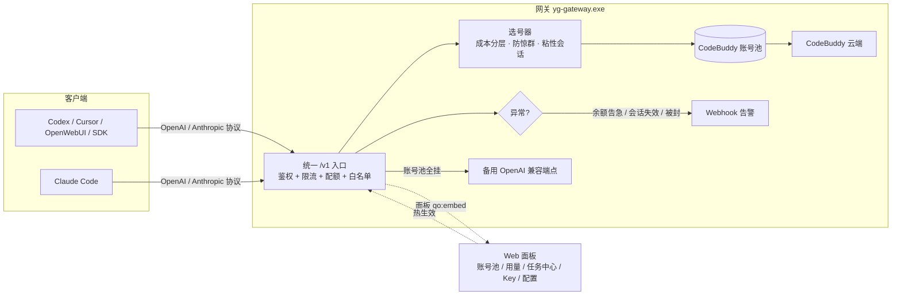

<div align="center">

# YG Gateway

**Self-hosted LLM gateway for Tencent CodeBuddy — OpenAI-compatible & Anthropic-compatible reverse proxy with account pool, model routing, usage tracking, and a single ~10 MB Go binary.**

单二进制 · 零依赖 · 养号友好 · 把一堆 CodeBuddy 账号变成一个统一的 `/v1` 端点。

[](LICENSE)
[](go.mod)
[](https://github.com/qiuqianyi66/yg-gateway)

**[功能特性](#功能特性) · [架构](#架构) · [快速开始](#快速开始) · [客户端接入](#客户端接入) · [安全基线](#安全基线部署必读) · [FAQ](#常见问题-faq)**

</div>

> ⚠️ **Unofficial gateway.** 仅用于你本人授权的 CodeBuddy 账号。请遵守腾讯 CodeBuddy 服务条款与所在地法律。

---

## 它是什么

**YG Gateway 是一个用 Go 写的自托管反向代理网关。** 它把你手里的多个腾讯 CodeBuddy 账号组成一个账号池，对外暴露成标准的 OpenAI 兼容 API 和 Anthropic 兼容 API。

任何按 OpenAI SDK 或 Anthropic SDK 写的客户端，填两行配置（base_url + api_key）就能直接用，零代码改动。

```
你的客户端 (Codex / Cursor / Claude Code / OpenWebUI / SDK)
        │  OpenAI / Anthropic 协议
        ▼
   yg-gateway.exe  ── 选号 / 养号 / 熔断 / 备用上游
        │
        ▼
   腾讯 CodeBuddy 账号池（N 个账号）
```

### HTTP 端点一览

| 协议 | Endpoint | 用途 |
|---|---|---|
| OpenAI Chat | `POST /v1/chat/completions` | Codex / Cursor / OpenWebUI / SDK，流式 SSE + 非流式 |
| OpenAI Models | `GET /v1/models` | 客户端自动发现模型列表 |
| OpenAI Responses | `POST /v1/responses` | Codex CLI 默认协议 |
| Anthropic Messages | `POST /v1/messages` | Claude Code 直连 |
| 健康检查 | `GET /healthz` | 监控 / 负载均衡探活 |
| Web 面板 | `GET /panel/` | 账号池 / Key / 配置 / 用量 |

## 谁该用 / 谁不该用

| 适合 | 不适合 |
|---|---|
| 手里有多个 CodeBuddy 账号、想统一用 OpenAI SDK 调 | 想做对外计费、多租户分发、兑换码 |
| 想让 Codex / Cursor / Claude Code 走 CodeBuddy 池 | 想接除 CodeBuddy 外的大量第三方 provider |
| 想让账号自动签到、活跃、做任务保积分 | 想要 SaaS 托管（这是自跑二进制） |
| 单机部署、不想装 Node / Python / Docker | 需要 Kubernetes 级水平伸缩 |

**明确不是什么**：不是多租户计费平台，不是通用 LLM 路由（上游就是 CodeBuddy + 一个备用 OpenAI 兼容源），不是一次性分析脚本。

### 什么时候选 YG Gateway，而不是 one-api / new-api

| 你的情况 | 选什么 |
|---|---|
| 手里是一堆 CodeBuddy 号，想统一成一个 OpenAI 兼容端点 | **YG Gateway** |
| 要接 OpenAI / Anthropic / Azure / Bedrock 全家桶，带团队计费和兑换码 | [one-api](https://github.com/songquanpeng/one-api) / [new-api](https://github.com/QuantumNous/new-api) |
| 只要一个反向代理，不要面板、不要养号、不要账号池 | 自己写个 nginx / Caddy 反代 |
| 单机跑，不想装 Node / Python / Docker | **YG Gateway**（~10MB 单二进制） |

## 为什么是它

同类项目不少（[workbuddy-manager](https://github.com/ithtelab/workbuddy-manager)、[workbuddy2api-hub](https://github.com/ardeyouxipianyi/workbuddy2api-hub)、[ARP](https://github.com/KaiXuanSama/ARP)、magpie…），它们拼的是**多租户派发、成本优化、功能广度**。YG Gateway 走的是另一条路。

<table>
  <tr>
    <td align="center" width="50%">
      <b>📦 单二进制零依赖</b><br/>
      面板 JS/CSS 经 <code>go:embed</code> 打进 ~10MB exe，拷到任意机器直接跑。<b>不需要 Node / Python / Docker</b>。Go ≥1.27.2 交叉编译即得多平台二进制。
    </td>
    <td align="center" width="50%">
      <b>🔄 养号友好选号</b><br/>
      快过期积分优先消耗、实测成本分层、积分保底、全自动养号（签到 / 活跃 / 旅行 / 保活 / 成长任务）。目标是<b>账号活得久、积分不浪费</b>。
    </td>
  </tr>
  <tr>
    <td align="center" width="50%">
      <b>🔒 安全底座加固</b><br/>
      禁 HTTP/2、入站 body 上限、受信任代理防伪造 XFF、Windows 凭证 ACL 加固、<code>subtle.ConstantTimeCompare</code> 密钥比较、CSP 响应头、<b>零遥测零回连</b>。
    </td>
    <td align="center" width="50%">
      <b>📋 工程治理可审计</b><br/>
      <code>.harness/</code> 下红线 + ADR + 变更追踪，每个改动可追溯。25 个 Go 包（22 个有测试）全绿，前端 node 断言回归。
    </td>
  </tr>
</table>

完整对比（含诚实劣势、magpie 源码级深读、未深读项标 unknown）见 [docs/COMPETITIVE-ANALYSIS.md](docs/COMPETITIVE-ANALYSIS.md)。

## 功能特性

### 账号池与可靠性

- **多账号池选号**：权重 = 积分 + 空闲加成 + 快过期加权；实测成本分层硬过滤；`pace_mode` 按"每小时剩余额度"分档（默认关）。
- **熔断与冷却**：402 硬冷却到次日 04:00；429 软冷却 600s 起指数退避（封顶 2h）；连续失败熔断 + **half-open 自动试探**（到期限速放行 1 次，避免洪峰二次打挂坏号）。
- **全局在途上限**：`pool.global_max_in_flight` 限制全网关并发，超限立即 429 + `Retry-After`。
- **会话粘性**：同一会话绑定同一账号，TTL 滚动续期，失败自动解绑，可镜像 Redis。
- **全自动养号**：签到 09/21、活跃上报 10、猫猫旅行 09/21、token 保活 22、夜猫子 23，五类独立开关。
- **连登管家**：签到末尾自动兑换已解锁档位并抽完抽奖次数。
- **成长任务**：17/18 个任务纯 API 一键完成，新号一轮约 +1950 积分 +78 能量。
- **积分保底**：`pool.credit_floor` 防止收费模型把余额打穿。
- **运维 Agent**：观察-建议闭环（容量告急 / 402 余额口径矛盾自动登记 unknown），面板可视，**默认关**。

### 模型与协议

- **OpenAI 兼容端点**：`POST /v1/chat/completions`（流式 SSE + 非流式）、`GET /v1/models`、`POST /v1/responses`（Codex 默认协议）。
- **Anthropic 兼容端点**：`POST /v1/messages`，Claude Code 直连。
- **模型别名**：`model_aliases` 把客户端短名映射到上游实际名，只改出站 body。
- **提示词体系**：网关层替换客户端 system prompt，从源头减少内容审核误报；`passthrough` 遇拦截自动降级重试。
- **原生工具调用还原**：DeepSeek 系标记文本还原为结构化 `tool_calls`。
- **结构化输出**：`response_format` 原样透传；`json_object` 已真机验证（2026-10-28，deepseek-v4-flash）；`json_schema` 形态未逐一实测（unknown）。
- **备用上游级联**：CodeBuddy 全挂时自动转发到独立 OpenAI 兼容端点，SSE 透传，用量归因到 `realm=fallback`。
- **延迟观测**：全局 + 按模型的 P50/P90/P95/P99（自实现固定分桶，零新依赖）。
- **用量归因**：按域 / 账号 / 模型 / **下游 Key** 四维聚合，CSV 一键导出（带 BOM，Excel 直接打开）。

### 多 API Key 派发（面板可视化，热生效）

| 字段 | 作用 |
|---|---|
| `models` | 模型白名单，支持通配符 `glm-*`、`*` |
| `realm` | 国内版 / 国际版 / 不限 |
| `rpm` | 每分钟请求上限，超限 429；0 = 不限 |
| `monthly_token_quota` | 当月 token 硬上限（跨重启持久化，跨月自动重置） |
| `group` | 账号池分组，Key 只能用同组账号 |

创建 Key 后弹窗直接给出 OpenAI / Anthropic 两段可复制配置，或一键下载 `yg-gateway-import.env`。明文仅创建时展示一次（服务端只存哈希）。

### Web 管理面板（go:embed 打进二进制）

单页九视图：账号池 / 用量 / 积分构成 / 任务中心 / 模型与档位 / API Key / 配置 / 运行日志 / 运维 Agent。启动后访问 `http://127.0.0.1:7863/panel/` 即可。

> 仓库不分发截图：画面里会出现真实账号昵称与 UUID 片段，属个人信息。

## 架构



- **鉴权**：SHA-256 摘要 + 常量时间比较；单 `api_key` 与多 `api_keys` 并存统一索引。
- **选号**：权重 = 积分 + 空闲加成 + 快过期加权，实测成本分层，硬过滤只留最优层；粘性会话把同一会话绑到同一账号，失败自动解绑。
- **热生效**：面板改配置 → 校验 → 落盘 → 重建鉴权/选号索引，无需重启。

## 快速开始

### 环境要求

- Go **≥ 1.27.2**（源码构建；更早版本带 9 个标准库 CVE，覆盖 `net/http` 与 HTTP/2）
- 一个或多个 CodeBuddy 账号（面板 OAuth 登录）
- 可选：Docker

### 安装

```bash
# 方式 1：go install（需要 Go ≥1.27.2）
go install github.com/qiuqianyi66/yg-gateway/cmd/server@latest

# 方式 2：从源码构建
git clone https://github.com/qiuqianyi66/yg-gateway.git
cd yg-gateway
CGO_ENABLED=0 go build -trimpath -ldflags="-s -w" -o yg-gateway ./cmd/server

# 方式 3：Docker（不需要本机 Go）
cp config.example.json config.json
docker compose up -d --build
```

```powershell
# Windows 从源码构建
$env:CGO_ENABLED = '0'
go build -trimpath -ldflags="-s -w" -o yg-gateway.exe ./cmd/server
```

首次启动自动生成 `config.json`（含 `crypto/rand` 随机 `api_key`，日志打印一次）。

```bash
# 健康检查
curl -s http://localhost:7863/healthz
# {"healthy":2,"total":2,"service":"yg-gateway"}
```

### 添加账号

打开 `http://127.0.0.1:7863/panel/` → 右上角「添加账号」→ 浏览器内完成 OAuth → 凭证落盘并**热加载进池，免重启**。新账号自动开始养号排程。

## 客户端接入

| 客户端 | Base URL | API Key 环境变量 |
|---|---|---|
| **OpenAI SDK / Codex CLI** | `http://127.0.0.1:7863/v1` | `OPENAI_API_KEY=<面板 Key>` |
| **Cursor / Continue / OpenWebUI** | `http://127.0.0.1:7863/v1` | API Key 栏填面板 Key |
| **Claude Code (Anthropic SDK)** | `http://127.0.0.1:7863` | `ANTHROPIC_AUTH_TOKEN=<面板 Key>` |
| **任意 OpenAI 兼容客户端** | `http://127.0.0.1:7863/v1` | 面板创建的 Key 或 `config.json` 的 `api_key` |

模型列表由客户端自动发现（`GET /v1/models`）。

### 与 Magpie / CC Switch 配合

YG Gateway 把 CodeBuddy 账号池包装成一个 OpenAI / Anthropic 兼容端点；**Magpie 和 CC Switch 管的是客户端侧的 provider 切换，两者正交，可叠加**：

- **Magpie**：在 provider 配置里加一个自定义 OpenAI 兼容端点，`base_url = http://127.0.0.1:7863/v1`，`api_key = 面板 Key`。Magpie 看到的"一个稳定可用的上游"，背后是 YG Gateway 在替你养 CodeBuddy 号。
- **CC Switch**：新增一个自定义 provider，`ANTHROPIC_BASE_URL = http://127.0.0.1:7863`，`ANTHROPIC_AUTH_TOKEN = 面板 Key`。切到这一档，Claude Code 的请求就落到本网关的 CodeBuddy 池。

## 进阶配置

### 模型映射 `model_aliases`

```json
"model_aliases": {
  "glm": "glm-5.3-flash",
  "ds": "deepseek-v4-flash"
}
```

只影响出站 body；选号 / 白名单 / 用量统计仍按客户端原始名。热生效。

### 异常告警 Webhook

```json
"alerting": {
  "webhook_url": "https://sctapi.ftqq.com/SENDKEY.send",
  "min_credit_threshold": 100,
  "dedup_minutes": 60
}
```

账号余额告急 / 被禁用 / 会话失效 / 触发熔断时 POST 通用 JSON 到 webhook，Server酱 / TG bot / 飞书自定义机器人直接接。

### 备用上游级联 `fallback`

```json
"fallback": {
  "enabled": true,
  "base_url": "https://api.deepseek.com/v1",
  "api_key": "sk-xxx",
  "models": ["deepseek-v4-flash"],
  "timeout_seconds": 120
}
```

只对白名单里的模型生效；SSE stream 原样透传。不配 = 完全关闭。

## 安全基线（部署必读）

1. **凭证文件权限（Windows 特有坑）**：`auths/*.json` 存明文 token，Go 的 `0o600` 在 Windows 上不改写继承 ACL。每次加完账号跑一次
   `powershell -ExecutionPolicy Bypass -File .\lock-auths.ps1`。
   服务本身已内置自动收紧（F-101），脚本仅作手动兜底。
2. **只监听本机**：`listen` 保持 `127.0.0.1:7863`。默认的 `:7863` 等同 `0.0.0.0`，会暴露到局域网。
3. **必设 api_key**：为空 = 完全不鉴权直接放行。
4. **公网部署**：服务本身只提供明文 HTTP，挂公网**必须**前置 HTTPS 反代（Nginx / Caddy）并配访问限制。
5. **构建工具链**：`go version` 确认 ≥1.27.2；定期跑 `go run golang.org/x/vuln/cmd/govulncheck@latest ./...`。

### 已加固 / 已审计项

| 项 | 状态 |
|---|---|
| 鉴权 | 未授权访问 `/panel/api/*` 返回 401 |
| 密钥比较 | SHA-256 摘要 + `subtle.ConstantTimeCompare`，常量时间，无计时侧信道 |
| 路径穿越 | UID 白名单 `[A-Za-z0-9_-]`，`..%2F` / `....//` 均返回 404 |
| 安全响应头 | CSP（`default-src 'none'`）/ nosniff / DENY / no-referrer / COOP / CORP |
| 日志脱敏 | 归档 JSONL 不含提示词、响应正文、Authorization；`state.json` 仅用量统计 |
| XSS | `esc()` 转义五字符；渲染函数实测 4 种 payload 注入均安全 |
| 遥测 / 回连 | **无**——无版本检查、无激活校验、无埋点，唯一外部依赖是可选 Redis |
| 依赖 | 仅 5 个模块（1 直接 + 4 传递，全部来自可选的 go-redis），`govulncheck` 零告警 |

## 开发

```bash
go build ./...
go vet ./...
go test ./...        # 完整测试套件（25 包：22 有测试 + 3 个 CLI 无测试）
gofmt -l ./cmd ./internal
node --check internal/panel/app.js
```

前端（`internal/panel/app.js`、`index.html`）经 `//go:embed` 打进二进制，**改动后必须重新编译才生效**。

### 构建环境注意

- `GOPROXY` 需设为 `https://goproxy.cn,direct`
- 交叉编译用 `GOOS` / `GOARCH`，`CGO_ENABLED=0`

## 常见问题 FAQ

**Q: YG Gateway 和 one-api / LiteLLM 有什么区别？**
A: one-api / LiteLLM 是通用 LLM 路由，接几十上百个 provider，主打多租户和计费。YG Gateway 只做一件事：把多个 CodeBuddy 账号养号、选号、跑稳。如果你要接 OpenAI、Anthropic、Azure、Bedrock 全家桶，选 one-api；如果你手里是一堆 CodeBuddy 号，想统一成 OpenAI 兼容端点，选 YG Gateway。

**Q: 支持 Claude Code 吗？**
A: 支持。网关暴露 Anthropic 兼容端点 `/v1/messages`，把 `ANTHROPIC_BASE_URL` 指向 `http://127.0.0.1:7863`，`ANTHROPIC_AUTH_TOKEN` 填面板 Key 即可。

**Q: 支持流式响应（SSE）吗？**
A: 支持。`/v1/chat/completions` 和 `/v1/responses` 都原生透传 SSE 流，备用上游级联也是 SSE 直透。

**Q: 部署需要 Docker 或 Node.js 吗？**
A: 不需要。单二进制 ~10MB，面板已经 `go:embed` 进去了。下载 exe 直接跑。Docker 是可选项。

**Q: 会上报遥测或连接外部服务器吗？**
A: 不会。无版本检查、无激活校验、无埋点。唯一的外部出站连接是你配置的 CodeBuddy 上游、可选的备用上游、可选的 Redis、可选的告警 webhook。

**Q: 用这个网关，CodeBuddy 账号会被封吗？**
A: 有风险。本项目是**非官方**网关，上游 CodeBuddy 是腾讯商业产品。作者不对账号封禁、条款违约或任何使用结果负责。请仅使用本人授权账号，遵守上游服务条款与所在地法律。

**Q: 支持多个人共享一个网关吗？**
A: 支持多 API Key 派发：每个下游 Key 可以设独立的模型白名单、rpm 限流、月度 token 配额、账号池分组。但这不是多租户计费系统——没有充值、没有兑换码、没有 OIDC。

**Q: 账号全挂了怎么办？**
A: 配置 `fallback` 备用上游（任何 OpenAI 兼容端点），CodeBuddy 池全挂时自动级联到备用源，用量单独归因到 `realm=fallback`。

**Q: 怎么处理账号 402 余额不足或 429 限流？**
A: 网关自动做冷却：402 硬冷却到次日 04:00，429 软冷却 600s 起指数退避（封顶 2h），连续失败进入熔断并 half-open 自动试探。面板账号池视图实时展示每个账号状态。

## 路线图

- 重置密钥时支持自定义新密钥（当前固定自动生成）
- 面板多语言 / 主题完善
- ~~更多上游接入~~ ✅ 已实现：`fallback.endpoints` 列表按序级联（ADR-015）

完整演进路线见 [docs/COMPETITIVE-ANALYSIS.md](docs/COMPETITIVE-ANALYSIS.md)。

## 免责声明

本项目是**非官方网关**，使用 CodeBuddy 账号作为上游，**仅限本人授权账号、本机或私有环境使用**。作者不对账号封禁、条款违约或任何使用结果负责。上游 CodeBuddy 属腾讯系商业产品，请遵守其服务条款与所在地法律。

## License

[MIT](LICENSE)。再分发时请保留原始出处声明。

---

<div align="center">

## Star History

[](https://star-history.com/#qiuqianyi66/yg-gateway&Date)

如果这个项目对你有用，欢迎给个 ⭐️ Star。

</div>
