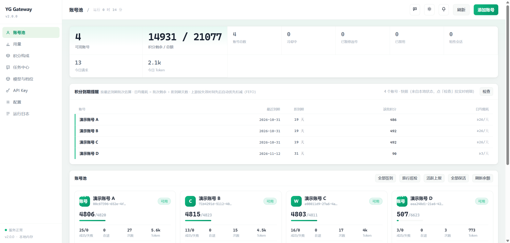
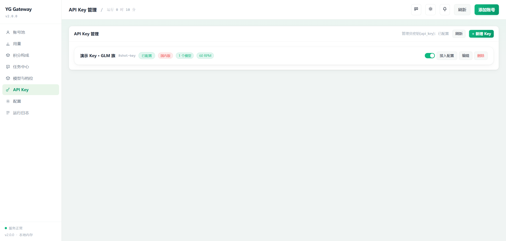
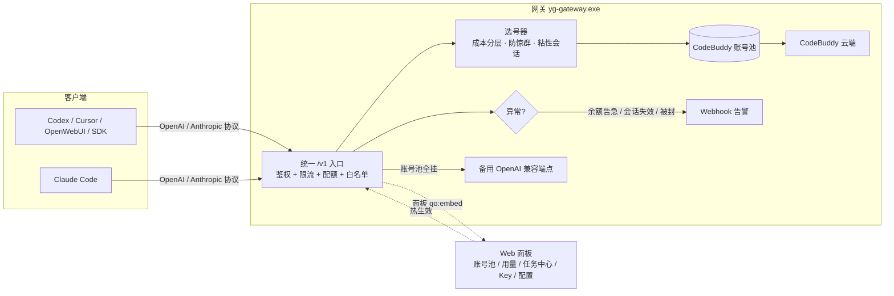

<div align="center">

# YG Gateway

**一个二进制、零依赖、养号友好的 CodeBuddy 网关**
——把"部署省心"和"账号活得久"两件事同时做对。

[](LICENSE)
[](go.mod)
[](https://github.com/qiuqianyi66/yg-gateway)

自托管的 **OpenAI / Anthropic 兼容反向代理网关**：把腾讯 CodeBuddy 账号池包装成统一的 `/v1` 服务，
附带 Web 管理面板与全自动养号。任何 OpenAI 兼容客户端（Codex / Cursor / OpenWebUI / SDK）与
Claude Code 填两行配置即可接入，零改造。

**[界面速览](#界面速览) · [架构](#架构) · [核心能力](#核心能力) · [快速开始](#快速开始) · [安全基线](#安全基线部署必读) · [开发](#开发)**

</div>

---

## 界面速览

| 账号池监控（余额 / 到期 / 今日用量） | API Key 管理（多 Key 派发 + 接入配置） |
|---|---|
|  |  |

## 为什么选 YG Gateway

同类项目不少（[workbuddy-manager](https://github.com/ithtelab/workbuddy-manager)、
[workbuddy2api-hub](https://github.com/ardeyouxipianyi/workbuddy2api-hub)、
[ARP](https://github.com/KaiXuanSama/ARP)…），它们拼的是**多租户派发、成本优化、功能广度**。
YG Gateway 走的是另一条路——四个它们普遍没做透的点：

<table>
  <tr>
    <td align="center" width="50%">
      <b>📦 单二进制零依赖</b><br/>
      面板 JS/CSS <code>go:embed</code> 进 ~10MB exe，拷到任意机器直接跑，<b>不需要 Node / Python / Docker</b>；Go ≥1.27.2 交叉编译即得五平台二进制
    </td>
    <td align="center" width="50%">
      <b>🔄 养号友好选号</b><br/>
      快过期积分优先、实测成本分层、积分保底、全自动养号（签到 / 活跃 / 旅行 / 保活 / 成长任务）——账号活得久、积分不浪费
    </td>
  </tr>
  <tr>
    <td align="center" width="50%">
      <b>🔒 安全底座加固</b><br/>
      禁 HTTP/2、入站 body 上限、受信任代理防伪造 XFF、Windows 凭证 ACL 加固、常量时间密钥比较、Go 1.27.2 零 stdlib CVE
    </td>
    <td align="center" width="50%">
      <b>📋 工程治理可审计</b><br/>
      <code>.harness/</code> 十阶段流程 + 红线 + 变更追踪，每个改动可追溯；20 个 Go 包测试全绿，前端 node 断言回归
    </td>
  </tr>
</table>

完整对比（含诚实劣势与路线图）见 [docs/COMPETITIVE-ANALYSIS.md](docs/COMPETITIVE-ANALYSIS.md)。

## 架构



- **鉴权**：SHA-256 摘要 + 常量时间比较；单 `api_key` 与多 `api_keys` 并存统一索引。
- **选号**：权重 = 积分 + 空闲加成 + 快过期加权，实测成本分层，硬过滤只留最优层；
  粘性会话把同一会话绑到同一账号，失败自动解绑。
- **热生效**：面板改配置 → 校验 → 落盘 → 重建鉴权/选号索引，无需重启。

## 核心能力

### 账号池与可靠性

| 能力 | 说明 |
|---|---|
| 多账号池 | 快过期积分加权 ×3、实测成本分层、加权随机选号、防惊群 |
| 熔断与冷却 | 402 硬冷却至次日 04:00、429 软冷却 600s 起指数退避（封顶 2h）、连续失败熔断 + **half-open 试探**（到期后限速放行 1 次，避免洪峰二次打挂）、在途租约限流 |
| 全局准入 | `pool.global_max_in_flight` 在途总数上限，超限立即 429 + `Retry-After`（防上游慢时请求堆积） |
| 会话粘性 | 同一会话绑定同一账号，TTL 滚动续期，失败自动解绑，可镜像 Redis |
| 全自动养号 | 签到 09/21、活跃上报 10、猫猫旅行 09/21、token 保活 22、夜猫子 23，五类独立开关 |
| 连登管家 | 签到末尾自动兑换已解锁档位并抽完抽奖次数 |
| 成长任务 | 17/18 个任务纯 API 一键完成，新号一轮约 +1950 积分 +78 能量 |
| 积分保底 | `pool.credit_floor` 防止收费模型把余额打穿 |

### 模型与网关

| 能力 | 说明 |
|---|---|
| 模型映射 | `model_aliases` 客户端短名 → 上游实际名，只改出站 body，观测口径不分裂 |
| 提示词体系 | 网关提示词替换客户端 system，从源头消灭内容审核误报；`passthrough` 遇拦截自动降级重试 |
| 原生工具调用还原 | DeepSeek 系标记文本还原为结构化 `tool_calls` |
| 备用上游级联 | CodeBuddy 全挂时自动转发到独立 OpenAI 兼容端点，SSE 透传，用量归因到 `realm=fallback` |
| 延迟观测 | 全局 + 按模型的 P50/P90/P95/P99（自实现固定分桶，零新依赖） |
| 用量归因 | 按域 / 账号 / 模型 / **下游 Key** 四维聚合，含积分扣除与缓存命中率 |
| 导出 | 请求记录 / 用量明细 / 积分扣除一键导出 CSV（带 BOM，Excel 直接打开） |

### 多 API Key 派发（面板可视化管理，热生效）

| 字段 | 说明 |
|---|---|
| `models` | 模型白名单，支持通配符：`glm-*` 放行整个 GLM 族，`*` 放行全部 |
| `realm` | 国内版 / 国际版 / 不限，约束这把 Key 只能用哪个版本的模型 |
| `rpm` | 每分钟最大请求数，超限 429；0 = 不限 |
| `monthly_token_quota` | 当月 token 硬上限（跨重启持久化，跨月自动重置），超限 429；0 = 不限 |
| `group` | 账号池分组：该 Key 只能用同组账号（auth 文件写 `"group": "team-a"`） |

创建 Key 后弹窗直接给出 **OpenAI / Anthropic 两段可复制的接入配置**，或一键下载
`yg-gateway-import.env` 落盘。明文仅创建时展示一次（服务端只存哈希）；万一弹窗误关，
卡片「接入配置」可回看完整配置，或「重置密钥」一键重新生成（旧 key 立即失效）。

## 快速开始

### 环境要求

- Go **≥ 1.27.2**（源码构建；更早版本带 9 个标准库 CVE，覆盖 `net/http` 与 HTTP/2）
- 一个或多个 CodeBuddy 账号（面板 OAuth 登录）
- 可选：Docker

### 源码构建（推荐本机）

```powershell
# Windows
$env:CGO_ENABLED = '0'
go build -trimpath -ldflags="-s -w" -o yg-gateway.exe ./cmd/server
.\yg-gateway.exe -config config.json
```

```bash
# Linux / macOS
CGO_ENABLED=0 go build -trimpath -ldflags="-s -w" -o yg-gateway ./cmd/server
./yg-gateway -config config.json
```

首次启动自动生成 `config.json`（含 `crypto/rand` 随机 `api_key`，日志打印一次）。

### Docker

```bash
cp config.example.json config.json
docker compose up -d --build
curl -s http://localhost:7863/healthz
# {"healthy":2,"total":2,"service":"yg-gateway"}
```

### 添加账号

打开 `http://127.0.0.1:7863/panel/` → 右上角「添加账号」→ 浏览器内完成 OAuth →
凭证落盘并**热加载进池，免重启**。新账号会自动开始执行养号排程。

### 接入客户端

| 客户端 | Base URL | API Key |
|---|---|---|
| OpenAI 兼容（Codex / Cursor / OpenWebUI / SDK） | `http://127.0.0.1:7863/v1` | 面板创建的 Key 或 `config.json` 的 `api_key` |
| Anthropic 兼容（Claude Code） | `http://127.0.0.1:7863` | 同上（`ANTHROPIC_AUTH_TOKEN`） |

面板里创建 Key 后可直接复制/下载现成配置，模型列表由客户端自动发现（`GET /v1/models`）。

## 进阶配置

### 模型映射 `model_aliases`

```json
"model_aliases": {
  "glm": "glm-5.3-flash",
  "ds": "deepseek-v4-flash"
}
```

只影响出站 body；选号 / 白名单 / 用量统计仍按客户端原始名。热生效。

### 异常告警 Webhook

```json
"alerting": {
  "webhook_url": "https://sctapi.ftqq.com/SENDKEY.send",
  "min_credit_threshold": 100,
  "dedup_minutes": 60
}
```

账号余额告急 / 被禁用 / 会话失效 / 触发熔断时 POST 通用 JSON 到 webhook，
Server酱 / TG bot / 飞书自定义机器人直接接。

### 备用上游级联 `fallback`

```json
"fallback": {
  "enabled": true,
  "base_url": "https://api.deepseek.com/v1",
  "api_key": "sk-xxx",
  "models": ["deepseek-v4-flash"],
  "timeout_seconds": 120
}
```

只对白名单里的模型生效；SSE stream 原样透传。不配 = 完全关闭。

## 调度可靠性（可选）

两个默认关闭/保守的参数，面板「配置」页可改，**热生效**：

- **`pool.global_max_in_flight`**（默认 `0` = 不限）：全网关在途请求总数上限，超限立即
  429 + `Retry-After`（不排队）。防上游慢时请求堆积，推荐 ≈ 账号数 × `max_in_flight` × 1.5。
- **`pool.breaker_probe_gap`**（默认 `"30s"`）：熔断到期后的 half-open 试探间隔，避免
  「到期瞬间洪峰把还是坏的号二次打挂」；设 `"0"` 关闭。

延迟分位数可在 `/status` 的 `latency` 段观察（全局 + 按模型 P50/P90/P95/P99）。

## 安全基线（部署必读）

1. **凭证文件权限（Windows 特有坑）**：`auths/*.json` 存明文 token，Go 的 `0o600` 在
   Windows 上不改写继承 ACL。**每次加完账号跑一次** `powershell -ExecutionPolicy Bypass -File .\lock-auths.ps1`
   （用 `icacls` 而非 `Set-Acl`）。确认当前状态：`(Get-Acl .\auths\*.json).AccessToString`
   应只剩你自己 + `SYSTEM`，出现 `BUILTIN\Users` 说明没加固。
2. **只监听本机**：`listen` 保持 `127.0.0.1:7863`。默认的 `:7863` 等同 `0.0.0.0`，会暴露到局域网。
3. **必设 api_key**：为空 = 完全不鉴权直接放行。
4. **公网部署**：服务本身只提供明文 HTTP，挂公网**必须**前置 HTTPS 反代（Nginx / Caddy）并配访问限制。
5. **构建工具链**：`go version` 确认 ≥1.27.2；定期跑 `go run golang.org/x/vuln/cmd/govulncheck@latest ./...`。

## 已加固 / 已审计项

| 项 | 状态 |
|---|---|
| 鉴权 | 未授权访问 `/panel/api/*` 返回 401 |
| 密钥比较 | SHA-256 摘要 + `subtle.ConstantTimeCompare`，常量时间，无计时侧信道 |
| 路径穿越 | UID 白名单 `[A-Za-z0-9_-]`，`..%2F` / `....//` 等均返回 404 |
| 安全响应头 | CSP（`default-src 'none'`）/ nosniff / DENY / no-referrer / COOP / CORP |
| 日志脱敏 | 归档 JSONL 不含提示词、响应正文、Authorization；`state.json` 仅用量统计 |
| XSS | `esc()` 转义 `& < > " '` 五字符；渲染函数实测 4 种 payload 注入均安全 |
| 遥测 / 回连 | **无**——无版本检查、无激活校验、无埋点，唯一外部依赖是可选 Redis |
| 依赖 | 仅 5 个模块（1 直接 + 4 传递，全部来自可选的 go-redis），`govulncheck` 零告警 |

## 面板（八视图，go:embed 打进二进制）

| 视图 | 说明 |
|---|---|
| 账号池 | 余额 / 到期提醒 / 成功失败 / 在途 / Token，签到·旅行·活跃·保活·余额刷新一键触发 |
| 用量 | 按域 / 账号 / 模型 / Key 聚合，CSV 导出 |
| 积分构成 | 包内额度拆解与到期批次 |
| 任务中心 | 成长任务一键完成 + 每日自动执行 |
| 模型与档位 | 模型级限流锁池可视化 |
| API Key | 多 Key 增删改 / 启停 / 接入配置 / 重置密钥 |
| 配置 | 全字段热生效编辑 |
| 运行日志 | 环形缓冲实时日志 |

## 开发

```bash
go build ./...
go vet ./...
go test ./...        # 完整测试套件（20 包：17 有测试 + 3 个 CLI 无测试）
gofmt -l ./cmd ./internal
node --check internal/panel/app.js
```

前端（`internal/panel/app.js`、`index.html`）经 `//go:embed` 打进二进制，**改动后必须重新编译才生效**。
前端有 node + vm 纯函数断言（`internal/panel/frontend_test.go`），后端有鉴权隔离 / 配置合并 / 脱敏回归测试。

### 构建环境注意

- `GOPROXY` 需设为 `https://goproxy.cn,direct`（本机 `proxy.golang.org` 不通）
- 交叉编译用 `GOOS` / `GOARCH`，`CGO_ENABLED=0`

## 路线图

- 重置密钥时支持自定义新密钥（当前固定自动生成）
- 更多上游接入（除 CodeBuddy 外的一键对接模板）
- 面板多语言 / 主题完善

（完整对比与演进路线见 [docs/COMPETITIVE-ANALYSIS.md](docs/COMPETITIVE-ANALYSIS.md)。）

## 免责声明

本项目是非官方网关，使用 CodeBuddy 账号作为上游，**仅限本人授权账号、本机或私有环境使用**。
作者不对账号封禁、条款违约或任何使用结果负责。上游 CodeBuddy 属腾讯系商业产品，
请遵守其服务条款与所在地法律。

## License

[MIT](LICENSE)。再分发时请保留原始出处声明。
